  

I work mainly on backend services in JavaScript/TypeScript and Python, though what drives me is software engineering as a whole: system design, Linux infrastructure, and building multi-agent development workflows using **Organic Driven Development (ODD)**.

### Current Focus & Active Work

| Project / Area | Description | Stack |
| :--- | :--- | :--- |
| **Agentic Workflows & ODD** | Multi-agent orchestration, verification pipelines, and ODD task-tracking tooling. | `TypeScript` · `Python` · `Node.js` |
| **Backend & Core Services** | Event-driven APIs, containerized microservices, and infrastructure automation. | `Node.js` · `Docker` · `Linux` |

### Links

- **Portfolio** — [ivanolivera.dev](https://ivanolivera.dev)
- **Digital Card** — [card.ivanolivera.dev](https://card.ivanolivera.dev)
- **LinkedIn** — [linkedin.com/in/ivan-olivera-gonzalez](https://linkedin.com/in/ivan-olivera-gonzalez)
- **Email** — [ivanoliveradev@gmail.com](mailto:ivanoliveradev@gmail.com)
