  

  
  
  
  

  

  The card is rendered from <a href="./src">src/</a> and the metrics by <a href="https://github.com/lowlighter/metrics">lowlighter/metrics</a>, refreshed daily by GitHub Actions.

